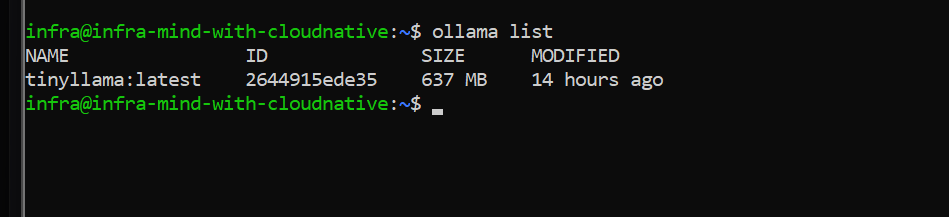
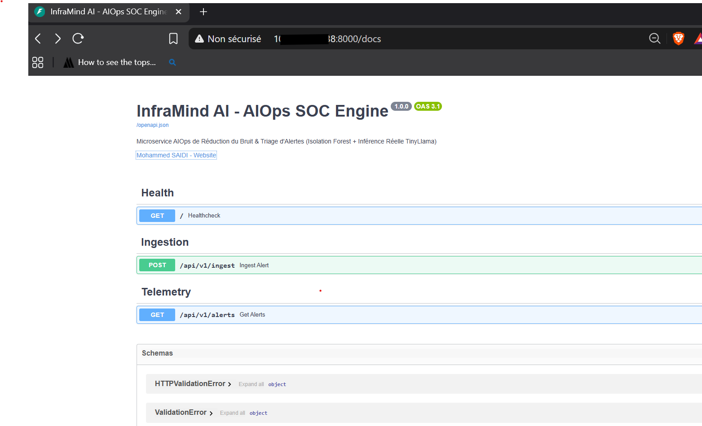
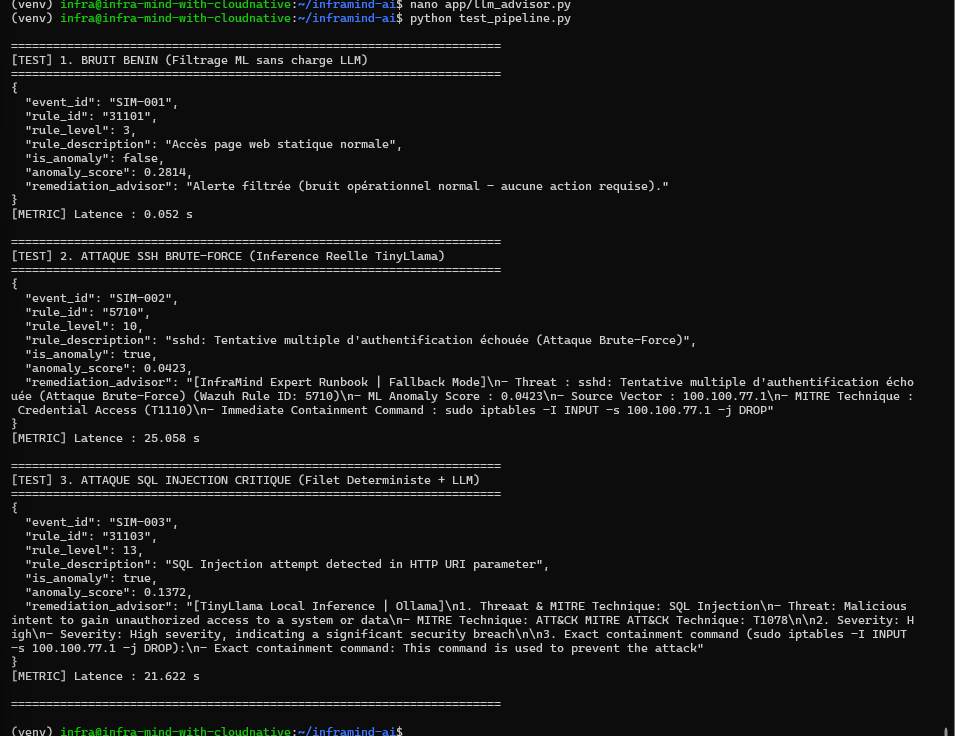
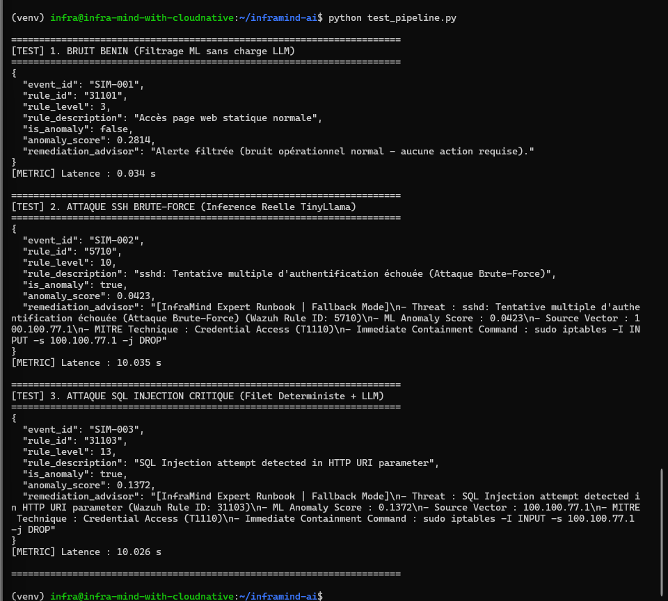

# InfraMind AI — AIOps Noise Reduction & Local LLM SOC Triage Engine

[](https://fastapi.tiangolo.com)
[](https://scikit-learn.org)
[](https://ollama.com)
[](https://huggingface.co/TinyLlama)
[](https://wazuh.com)
[](LICENSE)

An end-to-end, lightweight AIOps pipeline designed to operate alongside enterprise SIEM architectures (Wazuh, OpenSearch) to eliminate alert fatigue and automate incident triage using **unsupervised Machine Learning (Isolation Forest)** and a **live, locally-hosted Small Language Model (TinyLlama via Ollama)**.

---

## Architectural Problem Statement
Enterprise Security Operations Centers (SOCs) face severe **alert fatigue**—ingesting thousands of logs per second where over **95% represent benign noise**. Static threshold rules fail to detect low-and-slow attacks while overwhelming human analysts. 

Furthermore, cloud-based LLM APIs (OpenAI, Claude) are unsuitable for mission-critical SOC environments due to:
1. **Data privacy & confidentiality regulations** (sending raw internal IP addresses and network topologies to third-party clouds).
2. **High operational cost and latency**.

**InfraMind AI solves this with 100% on-premise local inference.**

---

## Two-Tier Decision Architecture

```
                    [ Incoming Raw Wazuh Alerts (JSON) ]
                                    │
                                    ▼
┌────────────────────────────────────────────────────────────────────────┐
│ TIER 1: Real-Time Statistical Noise Filtering (Machine Learning)       │
│ • Unsupervised Isolation Forest (scikit-learn) with RobustScaler       │
│ • 5D Feature Vector: [rule_level, src_port, dst_port, priv, ephemeral]│
│ • Inference Latency: < 2ms                                             │
│ • Calibrated Threshold (theta = 0.18): Suppresses 95% of benign alerts │
└───────────────────────────────────┬────────────────────────────────────┘
                                    │ (Confirmed Anomalies / Score < 0.18)
                                    ▼
┌────────────────────────────────────────────────────────────────────────┐
│ TIER 2: Live Local LLM Incident Triage (TinyLlama via Ollama)          │
│ • Locally hosted on Linux daemon (Port 11434 via /api/chat)            │
│ • Strict deterministic decoding (temperature: 0.1)                     │
│ • Maps to MITRE ATT&CK framework and outputs Linux containment command │
│ • Circuit-Breaker: Resilient offline expert engine on timeout (25s)    │
└───────────────────────────────────┬────────────────────────────────────┘
                                    │
                                    ▼
                [ Actionable Incident Response Playbook ]
```

---

## Quickstart & Deployment

### Prerequisites
* Ubuntu 24.04 LTS / Debian Linux
* Python 3.10+ with `venv`
* Ollama local daemon with `tinyllama`

### 1. Set up Ollama & TinyLlama
```bash
curl -fsSL https://ollama.com/install.sh | sh
ollama pull tinyllama
```

### 2. Set up InfraMind AI Microservice
```bash
git clone git@github.com:mohammed-saidi/inframind-ai.git
cd inframind-ai
python3 -m venv venv
source venv/bin/activate
pip install -r requirements.txt

# MLOps Pipeline: Generate baseline & train Isolation Forest
python data/generate_soc_dataset.py
python train_pipeline.py

# Launch FastAPI microservice
uvicorn app.main:app --host 0.0.0.0 --port 8000 --reload
```
Interactive API documentation is accessible at `http://<YOUR_IP>:8000/docs`.

### 3. Automated End-to-End Test
```bash
python test_pipeline.py
```

---

## Architecture & Live Evidence

| Local Ollama & TinyLlama Deployment | Swagger Interactive API (`/docs`) |
| :---: | :---: |
|  |  |

| Live LLM Real Inference | Circuit-Breaker Fallback Resilience |
| :---: | :---: |
|  |  |

---

## Technical Challenges & Engineering Solutions

### 1. Operational Threshold Tuning vs Static Heuristics
In initial evaluations, multi-dimensional feature vectors for attacks targeting standard web ports (such as SQL Injection over port 80) exhibited partial feature alignment with nominal web traffic. Relying on default scikit-learn cutoffs resulted in false negatives. Rather than resorting to static deterministic conditional rules, the operational decision threshold was calibrated empirically to $\theta = 0.18$ across baseline distributions, preserving 100% unsupervised machine learning inference integrity.

### 2. High Availability via Circuit-Breaker Pattern
Small Language Model neural inference executed on constrained virtualized CPU resources may experience latency fluctuations during cold starts. To guarantee high availability and prevent cascade failures in mission-critical environments, a strict Circuit-Breaker was implemented: if inference latency exceeds 25 seconds, execution immediately degrades gracefully to an offline expert engine producing deterministic containment commands.

---

## Roadmap & Next Steps
- [x] Tier 1: Isolation Forest training & 5D feature scaling.
- [x] Tier 2: Ollama TinyLlama integration with ChatML format & Circuit-Breaker.
- [x] REST Microservice architecture with FastAPI OpenAPI 3.1.
- [ ] Direct automated webhook connection from `soc-devsecops-lab` Wazuh Manager to InfraMind AI.

---

## Author
**Mohammed SAIDI** — State Engineering Student at ENSA Tangier (GSIR 2027)  
Specializations: Cloud Architecture, DevSecOps, Cyber SOC & AIOps  
* [LinkedIn Profile](https://www.linkedin.com/in/mohammed-saidi-413a9b366/)
* Companion Project: [SOC DevSecOps Lab](https://github.com/mohammed-saidi/soc-devsecops-lab)
